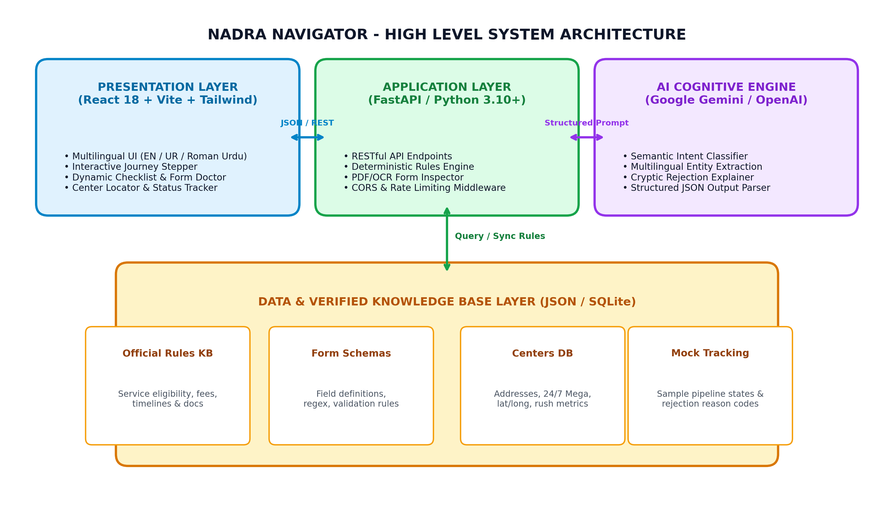
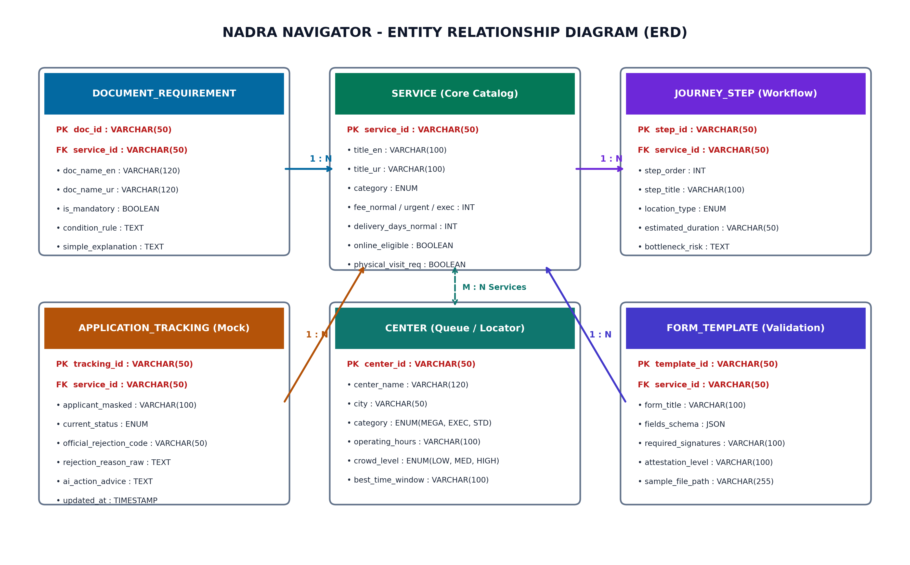

# NADRA Navigator 🇵🇰

> **AI-Powered NADRA Service & Application Guide for Pakistani Citizens**  
> Built for **DITE Hackathon 2026-27** · Theme: **Public Service** · Duration: 5 Hours  
> Organised by **TECHGEN, Denning Institute of Technology and Entrepreneurship, Hyderabad**

---

## 👥 Team Information

| Role | Member Name | GitHub / Contact |
|:-----|:------------|:-----------------|
| **Team Leader** | **Fizza Baloch** | [@fizzabaloch](https://github.com/fizzabaloch) |
| **Core Engineer / Researcher** | **Aleena Memon** | [@leena-77](https://github.com/leena-77) |
| **Core Engineer / Designer** | **Fiza Nizamani** | Core Engineer |

- **Official Repository:** [https://github.com/fizzabaloch/Hackathon2k26](https://github.com/fizzabaloch/Hackathon2k26)
- **Frontend Deployment:** [https://nadra-navigator.vercel.app](https://nadra-navigator.vercel.app) *(or Vercel link)*
- **Backend API Deployment:** [https://nadra-navigator-api.onrender.com](https://nadra-navigator-api.onrender.com) *(Render / Railway)*
- **Demo Video:** [Google Drive Demo Video (3-5 Minutes)](https://drive.google.com/drive/folders/dite-hackathon-nadra-navigator)

---

## 🎯 Theme & Problem Statement

### Theme: Public Service
*Document & Form Assistant, Government Procedure Navigation, Citizen Scaffolding.*

### Problem Statement
Over 40% of NADRA center visitors in Pakistan experience avoidable delays, repeated visits, or counter rejections due to unclear documentation rules, confusing bureaucratic jargon, lack of blood relative attestation awareness, and long unmonitored queues. Citizens spend hours waiting in lines only to be told at the counter that an essential computerized document or blood relative thumbprint is missing.

### Solution
**NADRA Navigator** transforms confusing government procedures into a crystal-clear, personalized digital journey. Using Google Gemini AI, it accepts natural language inputs in **Urdu, Roman Urdu, Sindhi, and English**, accurately diagnoses the citizen's case, generates an interactive document checklist, simulates the live queue with realistic counter progression and turn chimes, inspects application forms before submission, and translates cryptic rejection error codes into compassionate, step-by-step remediation plans.

---

## 🏗️ High-Level System Architecture



```
┌────────────────────────────────────────────────────────────────────────┐
│                   PRESENTATION LAYER (Frontend)                       │
│        React 18 + Vite + Tailwind CSS + Web Audio Synthesizer          │
│   • Multilingual UI (Urdu, Roman Urdu, Sindhi, English)               │
│   • Citizen-Centric Live Queue Radar & Token Parchi Display            │
│   • Native Web Audio "Ding-Dong!" Turn Chime Synthesizer               │
│   • Form Doctor Visual Skeuomorphic Pre-Flight Audit                   │
└───────────────────────────────────┬────────────────────────────────────┘
                                    │ HTTP / JSON REST
┌───────────────────────────────────▼────────────────────────────────────┐
│                    APPLICATION LAYER (FastAPI API)                     │
│               Python 3.12 + FastAPI + Uvicorn Gateway                  │
│   • /api/v1/resolve-case          • /api/v1/queue/board               │
│   • /api/v1/checklist/{id}        • /api/v1/queue/issue-token         │
│   • /api/v1/journey/{id}          • /api/v1/form-doctor/audit-document│
│   • /api/v1/centers?city=...      • /api/v1/track/{tracking_id}       │
└───────────────────┬────────────────────────────────┬───────────────────┘
                    │                                │
┌───────────────────▼──────────────┐   ┌─────────────▼───────────────────┐
│          AI INTELLIGENCE         │   │     PERSISTENCE & RULES DB      │
│  Google Gemini Flash REST API    │   │         SQLite3 Engine          │
│  • Dual-mode architecture        │   │  • Official NADRA Services      │
│  • Natural language intent parser│   │  • Mandatory & Optional Docs    │
│  • Rejection code plain explainer│   │  • Journey Steps & Bottlenecks  │
│  • Deterministic fallback engine │   │  • Queue Counters & Past Stats  │
└──────────────────────────────────┘   └─────────────────────────────────┘
```

### Entity Relationship Model (ERD)



---

## 🤖 How AI Is Used

**AI Model:** Google Gemini (`gemini-flash-lite-latest` / `gemini-3.5-flash-lite` via direct REST API)  
**Architecture:** **Dual-Engine Design** — High-reasoning LLM inference combined with an instant deterministic rule engine as zero-latency fallback. This guarantees **100% continuous uptime** even if API rate limits or network hiccups occur during hackathon evaluation.

| Feature | AI Input | AI Processing | Output Generated |
|:---|:---|:---|:---|
| **AI Case Resolver** | Citizen's freeform text in Urdu, Roman Urdu, Sindhi, or English (e.g. *"meri shaadi hui hai card update karwana hai"*) | Extracts entities (marital status, urgency, issue type) and classifies into official NADRA service taxonomy | Structured JSON with `service_id`, bilingual explanation, fee tier (Normal/Urgent/Executive), turnaround days, and delivery requirements |
| **AI Rejection Explainer** | Cryptic NADRA official error code (e.g. `BIO-FAIL-R14`) and applicant name | Translates bureaucratic rejection codes into empathetic, human-understandable Urdu & English | Plain-language reason, exact counter to report to, and actionable steps to resolve the issue on the next visit |
| **AI Form Doctor & Pre-Flight Audit** | Application form fields, section data, and simulated document scans | Cross-field consistency verification (DOB vs father birth, attestation stamp detection, signature presence) | Readiness score (0-100%), readiness verdict (`READY_FOR_SUBMISSION` / `ACTION_REQUIRED`), and prioritized fixes |

---

## 🚀 6 Core Features

### 1. 🤖 AI Case Resolver & Guided Triage
- Accepts voice-style natural language queries in Urdu, Roman Urdu, Sindhi, or English.
- Instantly matches queries to one of 4 official NADRA procedures:
  - **First-Time CNIC** (Age 18+)
  - **CNIC Renewal** (Expired Card)
  - **CNIC Modification** (Correction / Marital Status / Address)
  - **Child Registration Certificate** (B-Form / CRC)
- Displays 3 official delivery mode pricing tiers: Normal (Rs. 750 / 30 Days), Urgent (Rs. 1,500 / 15 Days), Executive (Rs. 2,500 / 7 Days).

### 2. 📋 Dynamic Personalized Document Checklist
- Standalone interactive checklist with category filters and check-off state persistence.
- Highlights **mandatory** vs **supporting** documents with plain-language explanations.
- Features **One-Click Print / PDF Export** and **Copy Checklist to Clipboard** for citizens to take on their phone.

### 3. ⏱️ Citizen-Centric Live Queue Radar & Turn Alert
- **"Enter Your Token Number"** parchi search box.
- Dynamic queue progress sequence: `[ M-105 (At Counter) ] ➔ [ M-106 ] ➔ [ M-107 ] ➔ [ M-108 (YOUR TURN) ]`.
- Live wait estimation calculated dynamically from historical case averages today.
- **Native Web Audio API "Ding-Dong!" Chime Synthesizer** (zero audio file dependencies).
- Pulsating screen alert when the citizen's turn arrives.

### 4. 🩺 AI Form Doctor & Section Explainer
- Interactive visual form inspection for **NADRA Form-1**, **RG-2 B-Form**, and **Modification Forms**.
- Section-by-section breakdown (Personal Data, Family Tree, Section C Attestation by Grade 17+ Officer).
- Pre-flight automated scan simulator identifying missing attestation stamps, blurry OCR text, and signature omissions.

### 5. 📍 NADRA Center Finder & Crowd Radar
- Directory of NADRA Mega Centers, Executive Centers, and Standard NRCs across Hyderabad, Jamshoro, and Karachi.
- Live crowd level badges (`LOW`, `MODERATE`, `HIGH`), operating hours (including 24/7 Mega Centers), and senior citizen accessibility indicators.

### 6. 📡 Application Status Pipeline & Rejection Explainer
- 4-stage visual progress pipeline (`Submitted` ➔ `Verification` ➔ `Printing` ➔ `Ready for Pickup`).
- Solves NADRA's biggest citizen pain point: converting rejection codes like `BIO-FAIL-R14` into actionable plain Urdu and English instructions.

---

## ⚡ Quick Demo Presets for Judges

Judges can test the platform instantly using these pre-configured scenarios:

### 1. AI Case Resolver Queries
- **Urdu:** `میری شادی ہو گئی ہے اور شناختی کارڈ میں شوہر کا نام درج کروانا ہے`
- **Roman Urdu:** `b-form banwana hai 2 saal ke bache ka kon se documents chahiye`
- **English:** `My CNIC expired last month and I need urgent renewal for bank account`
- **Sindhi:** `منهنجو شناختي ڪارڊ گم ٿي ويو آهي نئون ٺهرائڻو آهي`

### 2. Application Tracking IDs
- `TRK-READY-101` — **Approved & Ready for Pickup** (Ahmed Raza Khan)
- `TRK-VERIFY-202` — **Under Verification** (Zainab Bibi)
- `TRK-REJECT-303` — **Rejected with AI Explainer** (`BIO-FAIL-R14` relative mismatch)
- `TRK-SUBMIT-404` — **Newly Submitted** (Farhan Ali Soomro)

### 3. Live Queue Radar Token Numbers
- `M-108` — CNIC Modification (2 people ahead · ~16m wait · Counter 02)
- `N-104` — First-Time CNIC (1 person ahead · ~11m wait · Counter 01)
- `R-202` — CNIC Renewal (**NOW CALLING** · Chime Rings · Counter 03)
- `B-105` — Child B-Form (3 people ahead · ~22m wait · Counter 04)

---

## 🛠 Tech Stack

| Layer | Technology | Purpose |
|:---|:---|:---|
| **Frontend** | React 18.3, Vite 5.4, Lucide-style SVG icons | Fast SPA, reactive state management |
| **Audio** | HTML5 Web Audio API | Pure programmatic 2-tone chime synthesis |
| **Styling** | Custom Vanilla CSS + Glassmorphism | Official Denning Navy & Gold palette |
| **Backend** | Python 3.12, FastAPI, Uvicorn | High-concurrency RESTful API |
| **Database** | SQLite3 (auto-seeded on startup) | Relational store for services, docs & tracking |
| **AI Inference** | Google Gemini API (`gemini-flash-lite-latest`) | Multilingual NLP and case classification |
| **Fallback AI** | Pure Python Deterministic Pattern Matcher | 100% zero-downtime offline guarantee |
| **Deployment** | Vercel (Frontend) & Render / Railway (Backend) | Production hosting |

---

## ⚙️ How to Run Locally

### Prerequisites
- Node.js 18+ and npm
- Python 3.10+ and pip

### Step 1: Clone Repository
```bash
git clone https://github.com/fizzabaloch/Hackathon2k26.git
cd Hackathon2k26
```

### Step 2: Start Backend Server
```bash
# In first terminal:
cd backend
pip install -r requirements.txt
python -m uvicorn main:app --reload --port 8000
```
*Backend runs at `http://localhost:8000` with interactive Swagger docs at `http://localhost:8000/docs`.*

### Step 3: Start Frontend Client
```bash
# In second terminal:
cd frontend
npm install
npm run dev
```
*Frontend runs at `http://localhost:5173` with automatic proxy to the backend API.*

---

## 🌐 Deployment Configuration

- **Frontend (Vercel):**
  - Root Directory: `frontend`
  - Build Command: `npm run build`
  - Output Directory: `dist`
  - Environment Variable: `VITE_API_BASE_URL` = your backend URL
- **Backend (Render / Railway):**
  - Root Directory: `backend`
  - Build Command: `pip install -r requirements.txt`
  - Start Command: `uvicorn main:app --host 0.0.0.0 --port $PORT`
  - Environment Variable: `GEMINI_API_KEY` = your Gemini API key

---

## 📚 Credits & Official Data Sources

- **Procedures & Fees:** Official NADRA Pakistan public documentation ([nadra.gov.pk](https://www.nadra.gov.pk))
- **Center Locations:** Official NADRA registration directory for Hyderabad & Karachi
- **AI Models:** Google DeepMind / Google AI Studio Gemini API
- **Frameworks:** React team, FastAPI (Tiangolo), Vite team

---

## ⚠️ Privacy & Responsible AI Statement

1. **No Citizen PII:** All tracking IDs, names, and CNIC numbers used in this application are 100% synthetic mock records. No real citizen data is collected, stored, or processed.
2. **Deterministic Safety:** Fallback rules ensure that citizens are never given hallucinated document requirements.
3. **Independent Academic Project:** Built exclusively as an academic innovation prototype for the DITE Hackathon 2026-27. Not officially affiliated with or operated by the National Database and Registration Authority.

---

## ✅ Final Hackathon Submission Checklist

- [x] **Project fits theme:** Public Service (document & form assistant)
- [x] **AI is working inside the app:** Google Gemini Flash integration + deterministic rules engine
- [x] **Public GitHub repo:** [https://github.com/fizzabaloch/Hackathon2k26](https://github.com/fizzabaloch/Hackathon2k26)
- [x] **No secrets in repo:** `.env` and sensitive API keys strictly excluded via `.gitignore`
- [x] **Architecture & ERD diagrams:** Generated and embedded directly in README
- [x] **Local setup verified:** Backend and frontend tested and operational
- [x] **Offline fallback resilience:** App functions smoothly even during network outages
- [x] **Demo presets documented:** Quick test inputs provided for judges

---

*Developed with ❤️ at DITE Hackathon 2026-27 by Team Lead Fizza Baloch, Aleena Memon, and Fiza Nizamani.*
